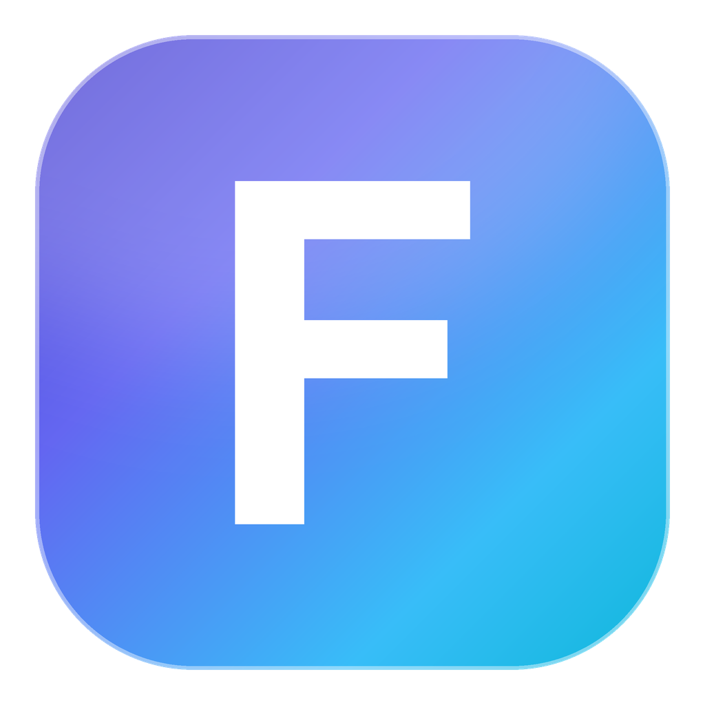

# Fund Pilot

[](https://github.com/wenxiang96/fund-pilot/releases)
[](https://github.com/wenxiang96/fund-pilot/releases)
[](https://github.com/wenxiang96/fund-pilot/actions/workflows/build.yml)
[](LICENSE)

> 基金 / 大盘 / 板块 / 股票 / 虚拟货币 菜单栏（状态栏）小应用，基于 Electron + React + TypeScript。

Fund Pilot 是一个常驻系统托盘的小工具：实时显示基金估值与持仓收益、指数行情、板块资金流、个股走势、
加密货币报价与财经新闻，点一下托盘图标即可展开面板。

> 所有行情数据均来自第三方公开接口，仅供参考，不构成任何投资建议。

## 功能

- **基金**：实时估值、持仓收益、成本价/份额管理、历史净值、同类排名、基金经理、重仓股、业绩走势
- **指数**：A股/国际指数、K 线、分时、经济数据（CPI/PPI/GDP/PMI、国债收益率、央行储备等）
- **板块**：资金流向、行业/概念排行、地域资金、北向/南向资金、涨跌分布
- **股票**：自选股、个股详情（分时/K线/资金流/公司资料/持仓基金）、龙虎榜、经济日历
- **货币**：CoinGecko / CoinCap 行情、K 线、历史走势、持仓计算器
- **钱包**：多钱包分组，基金/股票/指数/货币/H5 配置一键切换
- **其它**：托盘实时标题、右键菜单快捷操作、AI 截图识别导入基金、配置导入导出与云同步、
  主题色/暗色/简洁模式、全局快捷键、多窗口

## 技术栈

| 层 | 选型 |
| --- | --- |
| 桌面端 | Electron 38、menubar、electron-store、electron-updater |
| 构建 | electron-vite 4、Vite 7、electron-builder |
| 界面 | React 19、Ant Design 5、ECharts 6、CSS Modules |
| 状态 | Redux Toolkit、ahooks |
| 其它 | cheerio、undici、comlink（Worker）、openai |

## 下载

从 [Releases](https://github.com/wenxiang96/fund-pilot/releases) 获取最新版本：

| 文件 | 说明 |
|---|---|
| `FundPilot-<version>-portable.exe` | **绿色版（推荐）**，单文件免安装，数据在 exe 同级目录 |
| `FundPilot-Setup-<version>.exe` | NSIS 安装包，可自选安装目录 |

> Windows SmartScreen 对未签名 exe 可能提示「未知发布者」，点击「更多信息 → 仍要运行」即可。

## 开发

需要 Node.js >= 22.8、npm >= 10.9。

```bash
npm install          # 安装依赖
npm run dev          # 开发模式（electron-vite dev）
npm run build        # 仅构建产物到 release/app/dist
npm run package             # 构建并打包当前平台安装包（输出到 release/build）
npm run package-all         # 打包 macOS / Windows / Linux
npm run package-portable    # 只打 Windows 绿色版单文件 exe（免安装）
```

### Windows 绿色版

```bash
npm run package-portable
# 产物：release/build/FundPilot-<version>-portable.exe
```

单文件 exe，双击即可运行，**不写注册表、不写系统目录**：

- 首次启动会在 exe 同目录创建 `FundPilotData/`（配置 `config.json`、缓存、日志）
- 把 exe + `FundPilotData/` 一起拷走就是完整迁移，删掉文件夹即彻底卸载
- 需要管理员权限的安装流程、开始菜单项、开机自启注册项都不会创建（「开机自启」开关在绿色版下依赖系统登录项，可自行决定是否启用）

> 便携模式由 `src/main/portable.ts` 实现：检测 electron-builder 注入的 `PORTABLE_EXECUTABLE_DIR`，
> 命中时把 `userData` / `sessionData` / 日志目录重定向到 exe 同级目录。

图标资源由 `tools/make_icons.py` 生成（依赖 Pillow）：

```bash
python tools/make_icons.py
```

## 目录结构

```
src/
├── main/                 # 主进程：托盘、窗口、菜单、HTTP 代理、存储、自动更新
├── preload/              # 预加载脚本（contextBridge 暴露 contextModules）
├── renderer/
│   ├── components/       # 视图与通用组件（FundView / ZindexView / QuotationView / StockView / CoinView ...）
│   ├── services/         # 数据源请求实现（天天基金、东方财富、腾讯、CoinGecko ...）
│   ├── helpers/          # 收益计算、排序等纯逻辑
│   ├── store/            # Redux Toolkit slices 与 listeners
│   ├── utils/            # hooks、请求封装、格式化
│   ├── workers/          # 搜索与编解码 Web Worker
│   └── static/           # 地图、钱包图标等静态资源
├── build/                # 应用图标（icns / ico / png）
└── assets/               # 托盘模板图标、TouchBar 图标
```

## 数据源

- 基金：天天基金 / 蚂蚁基金 / 同花顺爱基金 / 腾讯证券
- 行情：东方财富（指数、板块、股票、资金流、龙虎榜）
- 货币：CoinGecko、CoinCap
- 新闻：东方财富、股吧

部分货币接口在部分地区不可直连，可在「设置 - 网络代理」中配置 http / socks 代理。

## 备份文件格式

右键菜单 →「导出全局配置」会生成 `.fp` 备份文件，内容为加密后的 JSON：

```json
{
  "name": "Fund-Pilot-Backup",
  "author": "wenxiang96",
  "version": "1.0.0",
  "content": "fp://...",
  "timestamp": 1700000000000,
  "suffix": "fp"
}
```

基金配置项（导入导出 JSON）字段：

```ts
interface FundSetting {
  code: string;   // 基金代码（必填）
  name?: string;  // 基金名称
  cyfe?: number;  // 持有份额
  cbj?: number;   // 持仓成本价
}
```

## 许可证

[GPLv3](LICENSE)

本项目为学习用途的复刻实现，界面与交互参考自开源项目 [Fishing Funds](https://github.com/1zilc/fishing-funds)（GPLv3），
在此感谢原作者的开源贡献。
